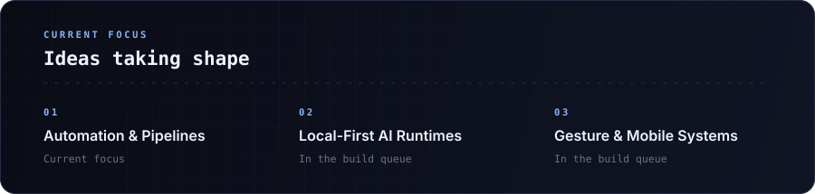
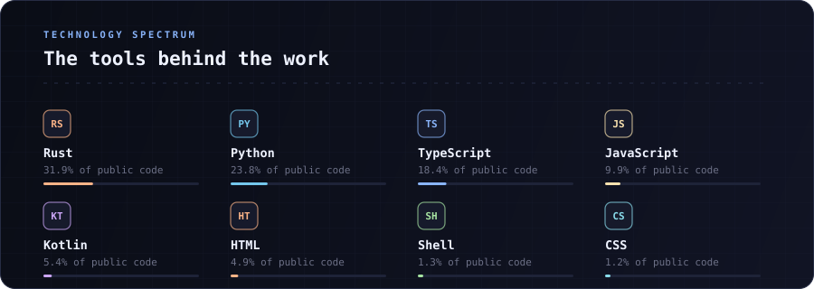
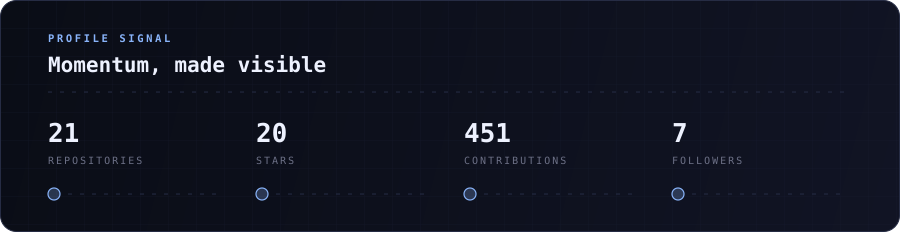
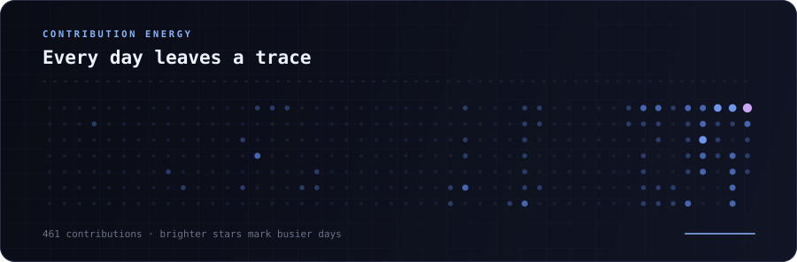
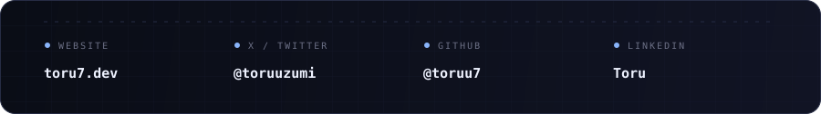

LIVING IDENTITY · TORU · LIVE

<picture>
  <source media="(prefers-color-scheme: light)" srcset="assets/hero-light.svg" />
  
</picture>

<strong>Automation Engineer & Systems Builder</strong>

If it is tedious, automate it. If it is sluggish, rebuild it in Rust. If it lacks feel, give it physics.

  <a href="https://toru7.dev">Website</a> &nbsp;·&nbsp;
  <a href="https://x.com/toruuzumi">X (@toruuzumi)</a> &nbsp;·&nbsp;
  <a href="https://linkedin.com/in/muhtadee-taron-b4253628b">LinkedIn</a> &nbsp;·&nbsp;
  <a href="mailto:sheikh.taron@northsouth.edu">Email</a>

✦ ───────────────────────────── ✦

<h2>Identity, with signal</h2>

<table width="100%">
  <tbody>
    <tr>
      <td width="62%">
        
If it is tedious, automate it. If it is sluggish, rebuild it in Rust. If it lacks feel, give it physics.

        
<strong>Focus:</strong> <code>Rust</code> · <code>Kotlin</code> · <code>TypeScript</code> · <code>Python</code>

        
Engineering high-throughput automation pipelines by day. Architecting local-first AI runtimes and gesture-driven systems by night.

      </td>
      <td width="38%">
        
<code>LIVE SIGNAL</code>

        

          <strong>21</strong> public repos 
          <strong>20</strong> stars 
          <strong>450</strong> contributions (1y) 
          <strong>7</strong> followers
        

      </td>
    </tr>
  </tbody>
</table>

✦ ───────────────────────────── ✦

<h2>What moves the work</h2>

<picture>
  <source media="(prefers-color-scheme: light)" srcset="assets/highlights-light.svg" />
  
</picture>

Positioning is useful when the proof is close behind it.

✦ ───────────────────────────── ✦

<h2>The tools behind the signal</h2>

<picture>
  <source media="(prefers-color-scheme: light)" srcset="assets/stack-light.svg" />
  
</picture>

Rust · TypeScript · Python · JavaScript · Kotlin · HTML · chosen for the work, not the trend

✦ ───────────────────────────── ✦

<h2>Momentum, made visible</h2>

<picture>
  <source media="(prefers-color-scheme: light)" srcset="assets/stats-light.svg" />
  
</picture>

✦ ───────────────────────────── ✦

<h2>The trail behind the work</h2>

<picture>
  <source media="(prefers-color-scheme: light)" srcset="assets/heatmap-light.svg" />
  
</picture>

7 day current streak · 70 active days

✦ ───────────────────────────── ✦

KEEP THE SIGNAL MOVING

<h2>Make something worth noticing</h2>

I like working with people who care about craft, context, and shipping the useful version.

<picture>
  <source media="(prefers-color-scheme: light)" srcset="assets/social-light.svg" />
  
</picture>

  <a href="https://toru7.dev">Website</a> &nbsp;·&nbsp;
  <a href="https://x.com/toruuzumi">X</a> &nbsp;·&nbsp;
  <a href="https://linkedin.com/in/muhtadee-taron-b4253628b">LinkedIn</a> &nbsp;·&nbsp;
  <a href="mailto:sheikh.taron@northsouth.edu">Email</a>

